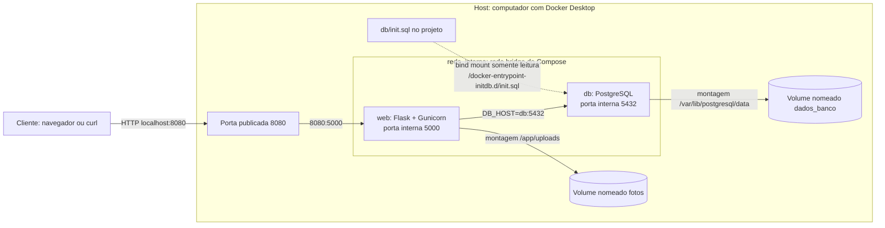

# Arquitetura local

O cliente e a porta 8080 ficam fora da `rede_interna`. Os dois contêineres pertencem à rede. O PostgreSQL não publica a porta 5432 no host; somente `web` pode alcançá-lo pelo nome `db` dentro da rede. Os volumes nomeados e o arquivo `db/init.sql` são recursos de armazenamento do host Docker, montados nos caminhos indicados dentro dos contêineres. O arquivo SQL é usado na primeira inicialização de um volume de banco vazio.

No Docker Desktop para Windows, os volumes são gerenciados pelo ambiente Linux do Docker. Os caminhos físicos observados na TAREFA 5 estão em [localização dos volumes](evidencias/tarefa5/02-localizacao.md).
