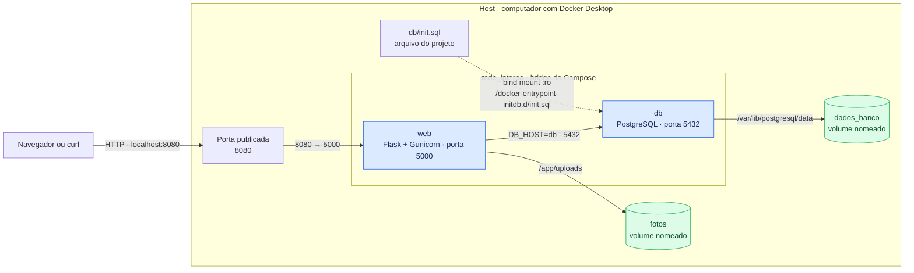

# Arquitetura do ambiente local

O cliente acessa a API pela porta **8080** do host. Dentro da rede do Compose, `web` se conecta ao PostgreSQL pelo nome `db` e pela porta **5432**. Os dados e as fotos ficam em volumes separados.

## O que fica dentro e fora da rede

| Elemento | Local e função |
| --- | --- |
| `web` e `db` | Contêineres ligados à `rede_interna`; o DNS do Docker permite que `web` encontre `db` pelo nome. |
| Porta 8080 | Publicada no host e encaminhada à porta 5000 de `web`. É o ponto de entrada do cliente. |
| Porta 5432 | Usada pelo banco **dentro da rede**; não é publicada no host. |
| `dados_banco` | Volume gerenciado pelo Docker, montado em `/var/lib/postgresql/data` no `db`. |
| `fotos` | Volume gerenciado pelo Docker, montado em `/app/uploads` no `web`. |
| `db/init.sql` | Arquivo do projeto no host, montado no `db` somente para leitura (`:ro`). |

O arquivo `init.sql` é executado pelo PostgreSQL apenas quando o volume do banco está vazio. Os volumes sobrevivem a `docker compose down`; `docker compose down -v` os remove. No Docker Desktop para Windows, os caminhos físicos dos volumes ficam no ambiente Linux do Docker, conforme a [inspeção da TAREFA 5](evidencias/tarefa5/02-localizacao.md).

**Evidência da rede:** [`docker network inspect`](evidencias/tarefa6/02-docker-network-inspect.json) mostra os dois contêineres conectados à rede bridge do projeto.
